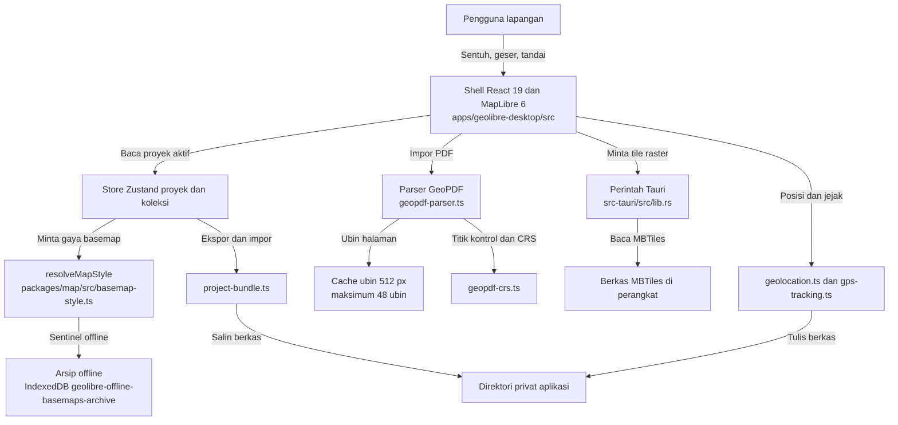
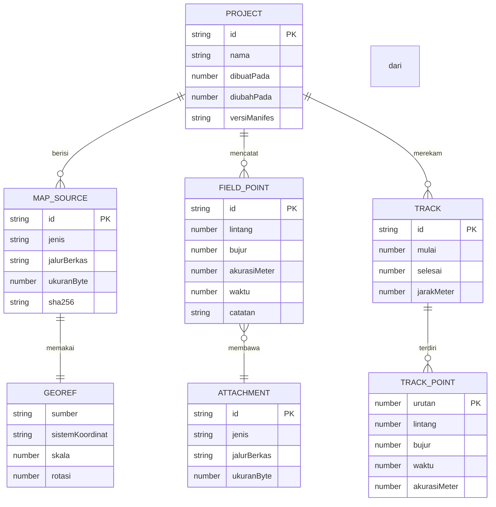

# GeoApps PRD

## 1. Overview

### Layer 1: Human PRD

| Field | Content |
|-------|---------|
| Problem Statement | Surveyor lapangan memakai Avenza Maps dengan batas 20 impor peta di paket Plus dan tanpa batas hanya di paket Pro berbayar, sedangkan berkas yang mereka bawa adalah PDF bergeoreferensi. Aplikasi yang ada menolak PDF itu karena parser hanya membaca metadata Info/XMP, bukan kamus halaman /VP, dan render PDF memakai satu kanvas raksasa pada skala 2: satu halaman A1 menjadi sekitar 95 juta piksel dan sekitar 380 MB RAM sebelum kompresi, cukup untuk membuat WebView Android dibunuh sistem di tengah pekerjaan. Gejala kedua yang sudah terukur: saat aplikasi dibuka tanpa sinyal, peta meminta gaya basemap ke internet sebelum proyek selesai dimuat, sehingga peta tampil kosong walau arsip offline sudah ada di perangkat (probe 2026-11-06 mencatat 2 permintaan ke CDN tile dan 1 peringatan fallback sebelum perbaikan). |
| Proposed Solution | GeoApps: aplikasi GIS lapangan berbasis Tauri v2 yang membuka PDF bergeoreferensi, memotongnya menjadi ubin, menyimpan peta dan proyek di dalam perangkat, lalu menampilkan posisi GPS di atasnya tanpa jaringan. Bahan bakunya sudah ada di repo (pengukur jarak, perekam jejak, koleksi lapangan, cache tile, georeferensi manual), jadi pekerjaan PRD ini adalah menyambungkan yang sudah ada dan menutup tiga akar masalah: georeferensi /VP, render berubin, dan proyek portabel. |
| Target Users | Persona utama: 1 sampai 5 surveyor atau pengelola kebun per organisasi di Indonesia, memakai ponsel Android kelas menengah dengan RAM 4 GB, bekerja di area tanpa sinyal, tingkat teknis rendah sampai sedang (memasang APK sendiri, membuka peta, menandai titik, memotret). Persona kedua: analis GIS kantor yang menyiapkan PDF atau GeoTIFF bergeoreferensi dan mengekspor hasil lapangan ke QGIS. |
| Scope and exclusions | Lingkup MVP: peta offline yang benar-benar jalan tanpa jaringan, impor GeoPDF dengan georeferensi sebenarnya, bundel proyek portabel, posisi GPS, rekam jejak, ukur jarak dan luas, titik lapangan dengan foto dan catatan. Di luar lingkup: what3words, GPS Bluetooth eksternal presisi tinggi, toko peta berbayar, langganan, kolaborasi real time, serta renderer ArcGIS dan Cesium yang tetap ada di repo tetapi bukan target PRD ini. Rincian fitur ada di bagian 3 dan batas kerja di kontrak Maintainability. |
| Decisions and assumptions | Keputusan yang sudah dipegang: aplikasi tidak dijual dan tidak punya akun pengguna; data tetap di perangkat; playbook rilis memakai satu workflow Android yang membangun APK per ABI dan AAB bertanda tangan, unggahan ke Play Console dijalankan owner secara manual. Asumsi yang belum terbukti: waktu start di ponsel Android fisik belum pernah diukur dengan alat ukur waktu, jadi semua angka p95 di kontrak SLO adalah target, bukan hasil. Angka RAM 380 MB berasal dari hitungan luas kanvas di dokumen riset, bukan dari profiler perangkat. |
| Research basis | factory/docs/riset/2026-10-19-paritas-avenza-android.md (akses 2026-10-19, sumber: daftar Google Play Avenza, dokumentasi driver PDF GDAL, ISO 32000-2 bagian 14.12, OGC 08-139r3, audit kode pada commit 4f73d2b1). Temuan yang belum divalidasi ulang: batas 20 impor peta di paket Plus, dan perkiraan konsumsi RAM render A1. Keduanya dipakai sebagai alasan prioritas, bukan sebagai angka penerimaan. |

### Goals & Success Metrics

| Goal | Metric | Target Value | Measurement Method |
|------|--------|--------------|--------------------|
| Peta offline terbuka tanpa menyentuh jaringan | Jumlah permintaan ke host tile CDN selama start tanpa jaringan | 0 permintaan pada 20 dari 20 percobaan | Catatan permintaan di probe Playwright yang menulis hasil ke berkas JSON |
| PDF bergeoreferensi tampil di koordinat yang benar | Berkas uji dengan /VP dan /LGIDict yang berhasil dibaca dan titik kontrol cocok | 3 dari 3 berkas, selisih di bawah 50 m | Uji satuan parser ditambah perbandingan titik kontrol yang sudah diketahui |
| Aplikasi tidak dibunuh sistem saat membuka peta besar | RAM puncak saat membuka peta A1 | Di bawah 512 MB | Profiler perangkat pada ponsel uji 4 GB RAM |
| Start sampai peta bisa digeser | Waktu p95 dari ikon ditekan sampai peta merespons gestur | Di bawah 3500 ms | 20 peluncuran berurutan pada perangkat uji |

### Layer 2: Machine Spec

| Constraint | Value |
|------------|-------|
| Product Type | app |
| Primary Platform | Android melalui WebView Tauri v2, dengan desktop dan web memakai kode yang sama |
| Deployment Target | Play Console untuk AAB bertanda tangan, ditambah rilis GitHub untuk APK dan installer desktop |
| Data Sensitivity | private: lokasi GPS, berkas peta lapangan, foto, dan catatan lapangan tinggal di perangkat pengguna |

## 2. Requirements

### Review Focus

Keputusan yang bisa membalik arah kerja sudah diturunkan jadi default di tabel ini, bukan jadi pertanyaan terbuka.

| Decision | Default applied | Why | Reversal cost |
|---|---|---|---|
| Target platform untuk MVP | Android lebih dulu, desktop dan web ikut karena satu basis kode | Keluhan nyata datang dari lapangan, dan Android adalah tempat render PDF gagal | 1 sampai 3 sprint bila urutan dibalik, karena pengujian perangkat berpindah |
| Format peta berkoordinat yang diimpor | GeoPDF dengan /VP dan /LGIDict lebih dulu, GeoTIFF menyusul | PDF adalah berkas yang benar-benar dibawa surveyor | Rendah: jalur GeoTIFF memakai pipeline raster yang sama |
| Batas RAM render per halaman | Ubin 512 px dengan cache maksimum 48 ubin | Menghindari kanvas raksasa tanpa membangun mesin render baru | Sedang: ukuran ubin menyentuh cache, worker, dan berkas uji |
| Tempat penyimpanan proyek | Direktori privat aplikasi ditambah bundel zip yang bisa diekspor | URI content:// mati bersama proses pemilih berkas | Rendah: pembaca bundel sudah ada di project-bundle.ts |
| Harga dan model bisnis | Tidak dijual, dipakai internal | Belum ada permintaan komersial dari owner, dan menagih butuh entitas serta dukungan | Rendah: menambah harga hanya menyentuh bagian 10 |

### Functional Requirements

| ID | Requirement | Priority | Rationale | Acceptance Criteria IDs |
|---|---|---|---|---|
| FR-001 | Aplikasi menahan layar start sampai basemap offline siap atau batas waktu habis, dan tidak meminta basemap default ke jaringan selama arsip offline tersedia | Must | Tanpa gerbang ini peta kosong di lapangan meski arsipnya ada | AC-001, AC-002, AC-003 |
| FR-002 | Impor PDF bergeoreferensi membaca /VP, /Measure, dan /LGIDict sehingga peta tampil pada koordinat sebenarnya | Must | Fitur nomor satu yang diminta owner; parser sekarang menolak PDF ArcMap, QGIS, dan Avenza | AC-004, AC-005 |
| FR-003 | Render PDF memakai ubin dengan cache berbatas, bukan satu kanvas penuh | Must | Satu kanvas A1 sekitar 95 juta piksel dan sekitar 380 MB RAM, penyebab aplikasi dibunuh sistem | AC-006 |
| FR-004 | Proyek disimpan sebagai bundel portabel yang menyalin berkasnya ke direktori privat aplikasi | Must | Tanpa salinan, membuka ulang proyek setelah aplikasi ditutup gagal | AC-007 |
| FR-005 | Posisi GPS tampil di atas peta tanpa jaringan, memakai plugin geolokasi native | Must | Inti pemakaian lapangan | AC-008 |
| FR-006 | Pengguna merekam jejak perjalanan dan menyimpannya sebagai berkas di perangkat | Must | Fitur yang diminta owner dan sudah ada di repo, tinggal dibuktikan di perangkat | AC-009 |
| FR-007 | Pengguna mengukur jarak dan luas dengan sentuhan yang nyaman di layar ponsel | Must | Alat ukur ada tetapi belum disesuaikan untuk sentuh | AC-010 |
| FR-008 | Pengguna menaruh titik lapangan berikut foto dan catatan, lalu melihatnya kembali | Must | Inti pekerjaan lapangan, batas foto 2 MB per berkas | AC-011 |
| FR-009 | Pengguna mengekspor dan mengimpor KML, GPX, dan CSV | Should | Menyambung hasil lapangan ke QGIS dan kantor | AC-012 |
| FR-010 | Pengguna memilih format koordinat DD, DMS, UTM, dan MGRS | Should | Angka koordinat yang dibaca lapangan bukan selalu desimal | AC-013 |

### Non-Functional Requirements

| ID | Category | Requirement | Target | Acceptance Criteria IDs |
|---|---|---|---|---|
| NFR-001 | Performance | Bundel awal tetap di dalam anggaran boot yang sudah ada di repo | 3145728 byte mentah dan 921600 byte gzip, diukur npm run bundle:report | AC-014 |
| NFR-002 | Reliability | Start tanpa jaringan tidak boleh meminta sumber daya peta ke host luar | 0 permintaan ke host tile luar, 0 peringatan fallback | AC-015 |
| NFR-003 | Accessibility | Setiap aksi punya sasaran sentuh dan jalur papan ketik yang jelas | Sasaran sentuh minimal 48 px, kontras WCAG 2.2 AA, label aksesibel pada tiap tombol ikon | AC-016 |
| NFR-004 | Security | Lokasi, foto, dan berkas peta tidak keluar perangkat tanpa aksi eksplisit pengguna | Tidak ada unggahan otomatis, tidak ada token di dalam repo, izin Android minimal | AC-017 |

### Conditional Reliability Contracts

| Contract | Required Detail | Acceptance Evidence or N/A |
|---|---|---|
| Timeout dan gerbang start | Gerbang proyek 10000 ms dan gerbang basemap offline 8000 ms, keduanya berhenti ke tampilan normal dan bukan ke layar kosong | AC-001 dan uji tests/offline-basemap-prewarm.test.ts |
| Retry baca tile | Baca tile MBTiles lewat perintah Tauri mengembalikan galat per tile, bukan menggagalkan seluruh peta | AC-006, uji packages/plugins/src/plugins/geopdf/geopdf-tile-cache.test.ts |
| Idempotensi impor bundel | Impor bundel yang sama dua kali tidak menggandakan berkas di direktori aplikasi | AC-007, uji tests/offline-project-bundle.test.ts |
| N/A: pembayaran dan langganan | Tidak ada transaksi di produk ini, jadi tidak ada kontrak idempotensi pembayaran | AC-017 menyatakan data tidak keluar perangkat |
| N/A: notifikasi terjadwal | Tidak ada pengiriman notifikasi otomatis; peringatan hanya muncul di layar saat aplikasi dibuka | AC-016 untuk umpan balik di layar |

### Acceptance Criteria

| ID | Requirement IDs | Observable Criterion | Required Evidence |
|---|---|---|---|
| AC-001 | FR-001 | 20 dari 20 peluncuran tanpa jaringan menampilkan peta yang bisa digeser | berkas `factory/docs/bukti/offline-start-20x.json` memuat 20 hasil sukses dan 0 permintaan ke host tile luar |
| AC-002 | FR-001 | Tanpa arsip offline, pemberitahuan muncul dalam 8000 ms dan bukan layar kosong | `tests/offline-basemap-prewarm.test.ts` keluar 0 untuk kasus tanpa arsip |
| AC-003 | FR-001 | Prewarm yang gagal menulis ringkasan kegagalan yang bisa dibaca | `tests/offline-basemap-prewarm.test.ts` memeriksa berkas ringkasan memuat kode galat |
| AC-004 | FR-002 | Tiga berkas uji georeferensi terbaca dan cocok dalam 50 m pada titik kontrol | `tests/geopdf-georef.test.ts` keluar 0 dan tabel selisih ditulis ke `factory/docs/bukti/georef-selisih.md` |
| AC-005 | FR-002 | PDF tanpa georeferensi menawarkan georeferensi manual dua titik dan hasilnya tersimpan | `tests/geopdf-manual-georef.test.ts` keluar 0 dengan berkas uji tanpa /VP |
| AC-006 | FR-003 | RAM puncak di bawah 512 MB dan ubin di cache tidak pernah melewati 48 | `tests/geopdf-tile-cache.test.ts` keluar 0 dan catatan profiler `factory/docs/bukti/ram-a1.txt` |
| AC-007 | FR-004 | Impor bundel dua kali menghasilkan satu entri proyek dan proyek terbuka setelah aplikasi ditutup | `tests/offline-project-bundle.test.ts` keluar 0 dan log `factory/docs/bukti-restore/drill-restore-071126-2035.md` |
| AC-008 | FR-005 | Posisi tampil dalam 5 detik setelah izin dan tetap tampil dengan mode pesawat aktif | `tests/geolocation-offline.test.ts` keluar 0 dan tangkapan layar `factory/docs/bukti/posisi-pesawat.png` |
| AC-009 | FR-006 | Jejak tersimpan berkala dan bisa diekspor lalu diimpor ulang tanpa kehilangan urutan waktu | `tests/gps-tracking.test.ts` keluar 0 dengan berkas `factory/docs/contoh-proyek/proyek-lapangan/jejak-1.csv` |
| AC-010 | FR-007 | Ukur jarak dan luas selesai dengan satu jari tanpa membuka menu tambahan | `tests/measure-touch.test.ts` keluar 0 dan rekaman `factory/docs/bukti/ukur-sentuh.mp4` |
| AC-011 | FR-008 | Titik lapangan dengan foto 2 MB tersimpan dan terbaca kembali setelah aplikasi ditutup | `tests/field-collection.test.ts` keluar 0 |
| AC-012 | FR-009 | Ekspor KML, GPX, dan CSV menghasilkan berkas yang lolos baca ulang | `tests/field-export.test.ts` keluar 0 untuk tiga format |
| AC-013 | FR-010 | Satu koordinat tampil benar dalam DD, DMS, UTM, dan MGRS dengan selisih di bawah 1 m | `tests/coordinate-format.test.ts` keluar 0 |
| AC-014 | NFR-001 | Bundel awal di bawah 3145728 byte mentah dan 921600 byte gzip | keluaran `npm run bundle:report` mencetak dua angka di bawah batas |
| AC-015 | NFR-002 | Start tanpa jaringan tidak meminta sumber daya peta ke host luar | berkas `factory/docs/bukti/offline-start-20x.json` mencatat 0 permintaan luar dan 0 peringatan fallback |
| AC-016 | NFR-003 | Sasaran sentuh 48 px, kontras WCAG 2.2 AA, label aksesibel pada tombol ikon | `tests/a11y-field-ui.test.ts` keluar 0 |
| AC-017 | NFR-004 | Izin Android minimal dan tidak ada unggahan otomatis | keluaran `aapt dump permissions` disimpan di `factory/docs/bukti/permissions.txt` |

### Traceability Matrix

| Feature | FR/NFR IDs | AC IDs | Required Evidence |
|---|---|---|---|
| FEAT-000 Fondasi aplikasi lapangan | NFR-001, NFR-004 | AC-014, AC-017 | `npm run bundle:report` dan `aapt dump permissions` di `factory/docs/bukti/permissions.txt` |
| FEAT-001 Peta offline | FR-001, NFR-002 | AC-001, AC-002, AC-003, AC-015 | `factory/docs/bukti/offline-start-20x.json` |
| FEAT-002 Impor PDF bergeoreferensi | FR-002 | AC-004, AC-005 | `tests/geopdf-georef.test.ts` dan `factory/docs/bukti/georef-selisih.md` |
| FEAT-003 Render berubin | FR-003 | AC-006 | `tests/geopdf-tile-cache.test.ts` dan `factory/docs/bukti/ram-a1.txt` |
| FEAT-004 Bundel proyek | FR-004 | AC-007 | `tests/offline-project-bundle.test.ts` dan `factory/docs/bukti-restore/drill-restore-071126-2035.md` |
| FEAT-005 Alat lapangan | FR-005, FR-006, FR-007, FR-008, NFR-003 | AC-008, AC-009, AC-010, AC-011, AC-016 | `tests/geolocation-offline.test.ts`, `tests/field-collection.test.ts`, `tests/a11y-field-ui.test.ts` |
| FEAT-005 Ekspor dan format koordinat | FR-009, FR-010 | AC-012, AC-013 | `tests/field-export.test.ts` dan `tests/coordinate-format.test.ts` |

### Bootstrap & First-Run Contract

| Field | Value |
|---|---|
| clean-checkout command | `git clone git@github.com:adi805/GeoApps.git && cd GeoApps && git checkout feat/offline-basemap-wiring` |
| runtime pin | Node 22 sesuai `.nvmrc` dan `engines.node >= 22`; Rust stable untuk perintah Tauri; Python 3 hanya untuk uji backend |
| install / dependency step | `npm ci`, lalu `npm run build:embed` karena paket embed dipakai predev dan prebuild |
| start command | `npm run dev` (Vite di port 5173, strictPort) atau `npm run tauri:dev` untuk jendela native |
| smoke check | `npm run typecheck:fast` keluar 0, lalu `curl -sf http://127.0.0.1:5173/` balik 200 |
| seed or fixture state | bundel contoh `factory/docs/contoh-proyek/bundel-proyek.zip` berisi manifes proyek, jejak, dan catatan |
| known environment traps | `vite build` mengosongkan `dist/`; port 5173 strictPort jadi gagal bila ada proses lain; `/mnt/hdd` read-only; uji yang menulis konfigurasi wajib memakai direktori sementara |
| first evidence of running | log Vite menyebut `Local: http://localhost:5173/` dan halaman memuat tulisan GeoApps, disimpan ke `factory/docs/bukti/bootstrap.log` |

## 3. Core Features

### FEAT-000: Fondasi aplikasi lapangan

> **Product Principle:** Aplikasi ini dinilai dari apa yang masih bisa dikerjakan saat tidak ada sinyal. Semua kapasitas jaringan dianggap tidak ada, kecuali pengguna menyatakan sebaliknya.

**Why:** tiga kegagalan lapangan yang dilaporkan owner semuanya terjadi tanpa jaringan: peta kosong, aplikasi ditutup sistem, dan proyek gagal dibuka ulang. Memperbaiki georeferensi saja tidak menolong bila aplikasinya tetap mati saat start tanpa sinyal.

**What:** paket Tauri v2 dengan WebView yang memuat bundel Vite, plugin geolokasi, penyimpanan direktori privat aplikasi, dan jalur raster MBTiles lewat perintah native.

**How it works:** frontend memuat bundel dari aset lokal, membaca arsip offline dari IndexedDB dan Cache Storage, lalu meminta tile raster ke Rust lewat perintah open_mbtiles, read_mbtiles_tile, dan read_mbtiles_zoom_range. Tidak ada permintaan jaringan pada jalur ini.

**Feature-specific acceptance criteria:**
- AC-017: profil rilis memuat izin ACCESS_FINE_LOCATION, ACCESS_COARSE_LOCATION, INTERNET, dan tidak memuat izin lokasi latar belakang; diperiksa dengan aapt dump permissions.

### FEAT-001: Peta offline yang menyala tanpa sinyal

> **Product Principle:** Peta kosong lebih buruk daripada aplikasi yang menolak start, karena pengguna sudah berjalan ke tengah lapangan sebelum tahu petanya tidak ada.

**Why:** probe 2026-11-06 mencatat dua permintaan ke CDN tile dan satu peringatan fallback saat start tanpa jaringan, padahal arsip offline sudah tersimpan. Akibatnya peta tampil kosong dan pengguna menyimpulkan arsipnya hilang.

**What:** gerbang start yang menahan pemuatan proyek sampai gaya basemap offline siap, dengan batas waktu yang jelas dan umpan balik di layar.

**How it works:** offline-basemap-startup.ts memeriksa sentinel gaya basemap, membaca arsip dari offline-basemap-archive.ts, lalu offline-basemap-restore.ts memulihkan gaya sebelum MapCanvas memuat proyek. Prewarm dijalankan di latar dengan batas waktu dan hasil ditulis ke ringkasan prewarm.

**Feature-specific acceptance criteria:**
- AC-001: dengan jaringan dimatikan, 20 dari 20 peluncuran menampilkan peta yang bisa digeser, tanpa satu pun permintaan ke host tile luar.
- AC-002: bila arsip offline tidak ada, aplikasi menampilkan pemberitahuan yang menyebut peta belum diunduh dalam 8000 ms, bukan layar kosong.
- AC-003: prewarm yang gagal menulis ringkasan kegagalan yang bisa dibaca, bukan diam.

### FEAT-002: Impor PDF bergeoreferensi

> **Product Principle:** Berkas yang pengguna sudah punya tidak boleh ditolak hanya karena produsennya berbeda.

**Why:** parser sekarang hanya membaca metadata Info dan XMP, jadi PDF keluaran ArcMap, QGIS, dan Avenza ditolak. Ini fitur nomor satu di daftar prioritas riset paritas, dan tanpa ini produk tidak bisa menggantikan Avenza sama sekali.

**What:** pembacaan kamus halaman /VP, /Measure, dan /LGIDict untuk mendapatkan sistem koordinat serta titik kontrol, lalu peta ditempatkan pada koordinat sebenarnya.

**How it works:** parseGeoPdfDocument di packages/plugins/src/plugins/geopdf/geopdf-parser.ts membaca objek halaman, georeferensi diselesaikan oleh geopdf-crs.ts, susunan struktur halaman oleh geopdf-structure.ts, dan penyediaan tile oleh geopdf-tiles.ts. Hasil georeferensi disimpan bersama proyek, bukan dihitung ulang tiap buka.

**Feature-specific acceptance criteria:**
- AC-004: tiga berkas uji dengan /VP dan /LGIDict terbaca dan menghasilkan kotak batas yang benar dalam toleransi 50 m pada titik kontrol.
- AC-005: PDF tanpa georeferensi tidak ditolak mentah, melainkan menawarkan georeferensi manual dengan dua titik, dan hasilnya tersimpan.

### FEAT-003: Render berubin dan cache berbatas

> **Product Principle:** Memori adalah sumber daya yang paling cepat habis di lapangan, jadi batasnya harus ditentukan di depan, bukan ditemukan lewat crash.

**Why:** satu halaman A1 pada skala 2 menjadi sekitar 95 juta piksel dan sekitar 380 MB RAM sebelum kompresi. WebView Android membunuh proses jauh sebelum angka itu tercapai.

**What:** ubin 512 px dengan cache maksimum 48 ubin dan pengosongan saat aplikasi masuk latar.

**How it works:** geopdf-tiles.ts memotong halaman menjadi ubin, geopdf-tiles-cache atau cache setara menyimpan ubin yang sedang dipakai, dan ubin dilepas ketika peta digeser jauh. Jalur MBTiles memakai perintah native read_mbtiles_tile sehingga tidak butuh kanvas besar.

**Feature-specific acceptance criteria:**
- AC-006: membuka peta A1 pada perangkat 4 GB RAM tidak melewati 512 MB RAM puncak dan tidak memicu pembunuhan proses; jumlah ubin di cache tidak pernah melewati 48.

### FEAT-004: Bundel proyek portabel

> **Product Principle:** Proyek adalah milik pengguna, bukan milik aplikasi. Kalau aplikasi hilang, proyeknya harus tetap bisa dibuka.

**Why:** tanpa salinan berkas, proyek mati bersama URI pemilih berkas. Ini juga yang membuat pengguna bisa memindahkan pekerjaan dari ponsel ke laptop.

**What:** bundel zip berisi manifes, berkas peta, koleksi lapangan, dan jejak, dengan perintah verifikasi sebelum dibuka.

**How it works:** importBundleFile menyalin berkas ke direktori privat aplikasi, verifyBundle memeriksa integritas manifes, openBundle memasang proyek, deleteBundle membersihkan berkas beserta salinannya.

**Feature-specific acceptance criteria:**
- AC-007: impor bundel yang sama dua kali menghasilkan satu entri proyek, dan proyek terbuka normal setelah aplikasi ditutup total.

### FEAT-005: Posisi, jejak, ukur, dan titik lapangan

> **Product Principle:** Pekerjaan lapangan adalah tiga gerakan: lihat posisi sendiri, catat yang ditemukan, ukur jaraknya. Ketiganya harus bisa dilakukan dengan sarung tangan dan satu tangan.

**Why:** posisi, rekam jejak, dan titik lapangan sudah ada di repo tetapi belum pernah dibuktikan di perangkat Android fisik; alat ukur belum disesuaikan untuk sentuh.

**What:** posisi GPS berjalan terus saat aplikasi terbuka, rekaman jejak disimpan sebagai berkas, alat ukur jarak dan luas dengan sasaran sentuh besar, titik lapangan dengan foto dan catatan.

**How it works:** geolocation.ts memakai plugin geolokasi native, gps-tracking.ts menulis rekaman berkala, field-collection.ts menyimpan titik dan foto ke direktori proyek, dan panel ukur memakai proyeksi lokal untuk menghitung jarak serta luas.

**Feature-specific acceptance criteria:**
- AC-008: posisi tampil dalam 5 detik setelah izin diberikan, dan tetap tampil dengan mode pesawat aktif.
- AC-009: rekaman jejak menghasilkan berkas yang bisa diimpor kembali ke QGIS tanpa kehilangan urutan waktu.
- AC-010: mengukur jarak dan luas bisa diselesaikan dengan jari tanpa membuka menu tambahan.
- AC-011: titik lapangan dengan foto 2 MB tersimpan dan terbaca kembali setelah aplikasi ditutup.
- AC-012: ekspor KML, GPX, dan CSV menghasilkan berkas yang lolos pembacaan ulang oleh aplikasi sendiri.
- AC-013: satu koordinat yang sama tampil benar dalam DD, DMS, UTM, dan MGRS dengan selisih di bawah 1 m.

## 4. User Flow

Alur utama dipakai sebagai urutan uji manual sebelum rilis. Setiap langkah punya jalur gagal yang wajib tampil di layar.

| Step | User Action | System Response | Error Path |
|---|---|---|---|
| 1 | Membuka aplikasi di area tanpa sinyal | Gerbang start berjalan, gaya basemap offline dipulihkan, peta tampil dan bisa digeser | Arsip tidak ada: pemberitahuan 8000 ms dengan tombol unduh peta saat ada jaringan |
| 2 | Memilih proyek dari daftar proyek terakhir | Proyek dimuat dari direktori privat, koleksi lapangan dan jejak dipasang | Bundel rusak: verifyBundle gagal dan pengguna diberi pilihan impor ulang |
| 3 | Memilih peta PDF bergeoreferensi | Peta ditempatkan pada koordinat sebenarnya dan ubin dimuat bertahap | /VP tidak ada: tawaran georeferensi manual dua titik |
| 4 | Menekan tombol posisi | Posisi sendiri tampil, peta mengikuti bila mode ikuti diaktifkan | Izin ditolak: penjelasan satu layar dengan jalan ke pengaturan |
| 5 | Memulai rekaman jejak lalu berjalan | Jejak digambar dan disimpan berkala | Penyimpanan penuh: rekaman berhenti dengan pemberitahuan, jejak yang sudah ada tetap utuh |
| 6 | Menaruh titik lapangan, memotret, menulis catatan | Titik tersimpan dengan foto dan catatan | Foto melebihi 2 MB: ditolak dengan saran kompresi |
| 7 | Mengukur jarak antara dua titik | Nilai jarak tampil di panel ukur | Titik kurang dari dua: tombol selesai nonaktif dengan alasan |
| 8 | Mengekspor proyek sebagai bundel | Bundel zip ditulis ke folder unduhan | Ruang tidak cukup: ekspor dibatalkan tanpa menyisakan berkas separuh |

## 5. Architecture

Batas lapisan yang dipegang: shell UI tidak pernah memanggil berkas langsung, semua akses berkas lewat perintah Tauri atau lapisan bundel. Paket packages/plugin tidak mengenal store aplikasi, jadi plugin bisa diuji tanpa menjalankan aplikasi. Jalur offline tidak memakai jaringan sama sekali, dan satu-satunya jalur jaringan yang tersisa adalah unduhan peta baru yang dipicu pengguna.

| Layer | Responsibility | Technology | Location |
|---|---|---|---|
| Shell aplikasi | Memuat bundel, memegang jendela, izin, dan perintah native | Tauri v2 dengan Rust | apps/geolibre-desktop/src-tauri |
| Antarmuka peta | Merender peta, panel, dan interaksi sentuh | React 19 dan MapLibre GL JS 6 | apps/geolibre-desktop/src |
| Logika peta bersama | Gaya basemap, sentinel offline, kanvas | TypeScript di paket bersama | packages/map/src |
| Plugin peta berkoordinat | Parsing GeoPDF, ubin, CRS | TypeScript di paket plugin | packages/plugins/src/plugins/geopdf |
| Penyimpanan perangkat | Arsip basemap, proyek, jejak, foto | IndexedDB, Cache Storage, direktori privat | apps/geolibre-desktop/src/lib |
| Layanan pendukung | Proksi AI, kolaborasi, tile, penampil | Cloudflare Workers | workers/ai-proxy, workers/collab, workers/tiles, workers/viewer |

### Threat Model Contract

| Field | Value |
|---|---|
| assets at risk | lokasi GPS pengguna, berkas peta lapangan, foto dan catatan lapangan, kunci API Worker yang dipakai proksi AI |
| trust boundaries | WebView dianggap tidak dipercaya terhadap sistem berkas, jadi semua akses berkas lewat perintah Tauri; berkas yang diimpor pengguna dianggap masukan asing; Worker di Cloudflare berada di luar batas perangkat |
| authentication model | tidak ada akun di aplikasi; Worker memakai kunci milik Worker sendiri yang disimpan sebagai secret, bukan di bundel klien |
| authorization model | hanya pemilik perangkat yang bisa membaca direktori privat aplikasi karena izin sistem operasi; tidak ada peran dan tidak ada multi pengguna |
| secrets handling | tidak ada kunci di repo maupun di bundel; kunci Worker disimpan lewat secret penyedia dan diputar bila ada indikasi bocor; pemeriksaan `SECRET_EXPOSED` di validator PRD menahan kunci yang tercetak di dokumen |
| data in transit & at rest | data lapangan tidak pernah dikirim otomatis dan disimpan tanpa enkripsi tambahan di direktori privat aplikasi, mengandalkan enkripsi disk sistem operasi; satu-satunya jalur keluar adalah unduhan peta yang dipicu pengguna |
| abuse cases | Spoofing berkas bundel dengan manifes palsu ditahan verifikasi checksum (AC-007); Tampering berkas proyek di direktori bersama ditahan sha256 per berkas; Repudiation titik lapangan ditahan cap waktu perangkat pada setiap titik; Information disclosure lokasi lewat berkas ekspor yang dibagikan ditahan peringatan saat berbagi; Denial of service lewat PDF raksasa ditahan batas 48 ubin dan 512 MB (AC-006); Elevation of privilege lewat plugin yang memanggil perintah native ditahan daftar perintah tetap di lib.rs |
| residual risk owner | Adi sebagai owner repo adi805/GeoApps, dicatat ulang setiap rilis |

### SLO & Performance Budget Contract

| Field | Value |
|---|---|
| service level indicator | persentase peluncuran tanpa jaringan yang menampilkan peta bisa digeser dalam batas waktu gerbang |
| slo target | 99% peluncuran tanpa jaringan berhasil |
| measurement window | rolling 28 hari |
| error budget policy | bila di bawah 99% pada satu jendela, pekerjaan fitur baru berhenti dan prioritas pindah ke gerbang start sampai dua jendela berturut-turut hijau |
| latency budget (p95) | p95 3500 ms dari ikon ditekan sampai peta merespons, dan p95 800 ms per tile 512 px pada perangkat uji |
| load expectation | 1 pengguna per perangkat, sampai 5 perangkat per organisasi, peta sampai 3 halaman A1 dan 200 titik lapangan per proyek |
| alert threshold | satu peluncuran gagal di tiga percobaan berturut-turut pada perangkat uji dianggap alarm, bukan noise |
| escalation owner | Adi, lewat lane offline 17 di factory/lanes.json |

### Integration Map Contract

| Module | Public Interface | Calls Into | Called By | Data Owned | Failure Mode | Contract Test |
|---|---|---|---|---|---|---|
| offline-basemap-restore.ts | export restoreOfflineBasemapForStyleUrl(styleUrl) | offline-basemap-archive.ts, packages/map basemap-style.ts | offline-basemap-startup.ts | tidak ada, hanya membaca arsip | arsip hilang: mengembalikan null dan start lanjut ke pemberitahuan | tests/offline-basemap-prewarm.test.ts |
| offline-basemap-archive.ts | export readOfflineArchiveBytes, export storeOfflineArchiveBytes | IndexedDB geolibre-offline-basemaps-archive | offline-basemap-restore.ts, offline-basemap-prewarm.ts | byte arsip basemap dengan prefiks basemap/ | kuota penuh: galat ditulis ke ringkasan prewarm, arsip lama tidak dihapus | tests/offline-basemap-archive.test.ts |
| geopdf-parser.ts | export parseGeoPdfDocument(file) | geopdf-crs.ts, geopdf-structure.ts | alur impor peta di apps/geolibre-desktop/src | hasil parse halaman dan kamus georeferensi | PDF tanpa /VP: mengembalikan hasil tanpa georeferensi dan UI menawarkan dua titik manual | tests/geopdf-georef.test.ts |
| geopdf-tiles.ts | export penyedia tile halaman | cache ubin 48 entri | MapCanvas saat peta digeser | ubin 512 px sementara | tile gagal: tile ditandai kosong, peta tetap jalan | tests/geopdf-tile-cache.test.ts |
| project-bundle.ts | export importBundleFile, export verifyBundle, export openBundle, export deleteBundle | direktori privat aplikasi lewat perintah Tauri | daftar proyek di apps/geolibre-desktop/src | manifes proyek dan salinan berkas | checksum salah: impor dibatalkan tanpa menyisakan berkas separuh | tests/offline-project-bundle.test.ts |
| lib.rs perintah mbtiles | open_mbtiles, read_mbtiles_tile, read_mbtiles_zoom_range, read_mbtiles_metadata | sqlite3 crate dan berkas MBTiles | mbtiles.ts di WebView | tidak ada, hanya membaca berkas | berkas tidak ada: galat per perintah, bukan panik | `cargo check --manifest-path apps/geolibre-desktop/src-tauri/Cargo.toml` |

### Builder Capability Routing Contract

Sebelum mengerjakan salah satu baris di bawah, sesi pembangun wajib inspect the host-provided available skill/tool catalog dan menandai rute pilihan sebagai UNAVAILABLE bila benar-benar tidak ada, bukan menganggapnya ada.

| Trigger | Required Capability | Preferred Skill/Tool If Available | Fallback If Unavailable | Required Evidence | Authority |
|---|---|---|---|---|---|
| Memeriksa struktur PDF bergeoreferensi | membaca objek PDF dan kamus halaman | tool parse_document dan pdf_to_images | pembaca qpdf lewat bash untuk membedah objek halaman | keluaran objek halaman yang memuat /VP atau /LGIDict | dokumen ini bagian 3 FEAT-002 |
| Membuktikan peta tampil tanpa jaringan | otomasi peramban dan rekaman permintaan | `playwright test` dengan proyek core | probe Playwright manual ke jendela Vite | berkas `factory/docs/bukti/offline-start-20x.json` berisi 20 hasil | dokumen ini bagian 2 AC-001 |
| Menjalankan uji dan pemeriksaan tipe | runner uji Node dan pemeriksa tipe | `npm run test:frontend` dan `npm run typecheck:fast` | `npm run ci:web` bila kedua perintah itu tidak cukup | keluaran keluar 0 disimpan ke `factory/docs/bukti/uji.log` | dokumen ini bagian 2 AC-014 |
| Menguji perintah Rust | kompilasi dan pemeriksaan Rust | `cargo check` lewat CI GitHub Actions | `bash ~/.opencrabs/projects/oc-sanity.sh` untuk pemeriksaan statis lokal | ringkasan job CI yang hijau pada commit yang diuji | dokumen ini bagian 9 Maintainability |
| Memeriksa tampilan di perangkat Android | perangkat fisik atau emulator dengan WebView | `npm run tauri:dev` ke perangkat uji | tangkapan layar Vite di peramban sebagai bukti sementara yang wajib ditandai belum di perangkat | berkas `factory/docs/bukti/perangkat.txt` berisi model, versi Android, dan hasil | dokumen ini bagian 2 AC-008 |

## 6. Data Models

Bentuk data mengikuti apa yang sudah dipakai repo: proyek disimpan sebagai satu manifes JSON di direktori privat aplikasi dengan kunci proyek, koleksi lapangan sebagai berkas terpisah yang dirujuk manifes, dan arsip basemap di IndexedDB dengan prefiks kunci basemap/ di basis data geolibre-offline-basemaps-archive. Karena bentuk ini sudah berjalan, perubahan skema wajib menyertakan pembaca versi lama.

| Entity | Storage | Key | Notes |
|---|---|---|---|
| PROJECT | JSON di direktori privat aplikasi | id proyek | Manifes memuat daftar sumber peta, koleksi, dan jejak |
| MAP_SOURCE | Berkas di direktori proyek | id sumber dalam manifes | Menyimpan sha256 agar verifikasi bundel bisa jalan |
| GEOREF | Bagian dari manifes | id sumber | Hasil parsing disimpan, tidak dihitung ulang |
| FIELD_POINT | JSON koleksi lapangan | id titik | Foto dirujuk lewat ATTACHMENT, batas 2 MB per berkas |
| TRACK | Berkas terpisah per rekaman | id jejak | Ditulis berkala, bukan di akhir sesi |

## 7. Design System

| Token | Value | Usage |
|---|---|---|
| --color-bg | #0f172a | Latar panel dan shell |
| --color-surface | #1e293b | Kartu, panel, dan daftar |
| --color-text | #e2e8f0 | Teks utama |
| --color-muted | #94a3b8 | Teks sekunder dan label |
| --color-accent | #38bdf8 | Aksi utama dan status aktif |
| --color-danger | #f87171 | Galat, hapus, kehilangan sinyal |
| --radius-md | 8px | Tombol dan kartu |
| --space-unit | 4px | Satuan jarak dasar untuk semua padding |
| --touch-target | 48px | Sasaran sentuh minimum untuk semua tombol |
| --font-ui | system-ui | Teks antarmuka, menghindari unduhan font |
| --font-mono | ui-monospace | Koordinat dan nilai ukur |

Aturan tampilan yang dipegang: koordinat selalu huruf kapital dan monospace supaya tidak salah baca di bawah matahari; tombol lapangan minimal 48 px karena dipakai dengan sarung tangan; status offline selalu terlihat, bukan hanya saat gagal; mode gelap adalah bawaan karena aplikasi dipakai pagi dan malam; tidak ada animasi yang menahan input.

### Design System & UX Contract

| Field | Value |
|---|---|
| design tokens source | variabel CSS di `apps/geolibre-desktop/src/styles/tokens.css` dan tema MapLibre di `packages/map/src/basemap-style.ts` |
| component inventory | peta kanvas MapCanvas, panel proyek, tombol posisi, panel ukur, daftar titik lapangan, lembar detail titik, dialog impor, bilah status offline |
| ui states | empty: belum ada proyek dan belum ada peta diunduh; loading: gerbang start dengan bilah kemajuan; error: bundel rusak, izin ditolak, arsip hilang; success: peta siap dan titik tersimpan; partial atau degraded: arsip sebagian termuat dan peta tampil dengan peringatan |
| accessibility target | WCAG 2.2 AA, sasaran sentuh 48 px, kontras teks minimal 4.5 banding 1 |
| responsive breakpoints | 360 px ponsel kecil, 412 px ponsel umum, 768 px tablet, 1024 px desktop; panel berubah jadi laci di bawah 768 px |
| content & copy rules | bahasa Indonesia, kalimat perintah pendek, angka koordinat selalu monospace dan huruf kapital, tidak ada singkatan yang tidak dijelaskan di layar |
| design owner | Adi, dengan lane visual 157 di factory/lanes.json sebagai pelaksana |

## 8. API Spec

Ada dua jenis permukaan: perintah Tauri yang dipanggil dari WebView, dan perintah HTTP di Worker. Perintah Tauri memakai pola result Rust, jadi galat muncul sebagai objek dengan kode dan pesan, bukan lemparan mentah.

| Method | Path | Request | Response | Auth | Error Codes |
|---|---|---|---|---|---|
| IPC | open_mbtiles | jalur berkas | ringkasan metadata peta | tidak ada, lokal di perangkat | FILE_NOT_FOUND, NOT_MBTILES, PERMISSION_DENIED |
| IPC | read_mbtiles_tile | jalur, z, x, y | byte tile | tidak ada, lokal di perangkat | TILE_OUT_OF_RANGE, DECODE_ERROR, FILE_NOT_FOUND |
| IPC | read_mbtiles_zoom_range | jalur | zoom minimum dan maksimum | tidak ada, lokal di perangkat | NOT_MBTILES, FILE_NOT_FOUND |
| IPC | read_mbtiles_metadata | jalur | pasangan kunci dan nilai metadata | tidak ada, lokal di perangkat | NOT_MBTILES |
| IPC | import_bundle_file | jalur bundel, id proyek | manifes proyek | tidak ada, lokal di perangkat | BUNDLE_INVALID, CHECKSUM_MISMATCH, NO_SPACE |
| IPC | verify_bundle | jalur bundel | hasil verifikasi | tidak ada, lokal di perangkat | CHECKSUM_MISMATCH, MANIFEST_MISSING |
| IPC | delete_bundle | id proyek | status hapus | tidak ada, lokal di perangkat | PROJECT_NOT_FOUND, FILE_BUSY |

| Method | Path | Request | Response | Auth | Error Codes |
|---|---|---|---|---|---|
| POST | /api/ai | pesan dan konteks | jawaban model | kunci di sisi Worker | RATE_LIMITED, UPSTREAM_ERROR |
| GET | /health | tidak ada | status hidup | tidak ada | 503 saat dependensi mati |
| GET | /room/:id | id ruang | status ruang kolaborasi | tiket ruang | ROOM_NOT_FOUND, TICKET_EXPIRED |

### Data Fetching Patterns

Ambil tile saat peta digeser, bukan saat proyek dibuka, karena pengguna sering hanya butuh satu sudut peta. Simpan ubin yang baru dipakai di cache depan dengan batas 48 ubin dan buang yang paling lama. Baca tile MBTiles lewat perintah IPC karena berkasnya di luar jangkauan WebView. Saat aplikasi masuk latar, kosongkan cache ubin dan hentikan prewarm supaya memori tidak ditahan sistem. Setiap kegagalan satu tile hanya menandai tile itu, tidak menghentikan peta.

## 9. File Map

| File Path | Purpose | Key Exports |
|---|---|---|
| apps/geolibre-desktop/src/lib/offline-basemap-archive.ts | Menyimpan dan membaca arsip basemap offline di IndexedDB | offlineArchiveKey, storeOfflineArchiveBytes, readOfflineArchiveBytes, listStoredOfflineArchiveIds |
| apps/geolibre-desktop/src/lib/offline-basemap-restore.ts | Memulihkan gaya basemap offline dari arsip sebelum peta dimuat | restoreOfflineBasemapForStyleUrl, offlineBasemapIdFromSentinel |
| apps/geolibre-desktop/src/lib/offline-basemap-startup.ts | Gerbang start dan urutan pemulihan basemap | fungsi gerbang start dan batas waktu |
| apps/geolibre-desktop/src/lib/offline-basemap-prewarm.ts | Memanaskan arsip basemap di latar dan menulis ringkasan hasil | fungsi prewarm dan ringkasan |
| apps/geolibre-desktop/src/lib/project-bundle.ts | Impor, verifikasi, buka, dan hapus bundel proyek | importBundleFile, verifyBundle, openBundle, deleteBundle |
| apps/geolibre-desktop/src/lib/mbtiles.ts | Pembungkus perintah MBTiles untuk WebView | pembaca tile dan metadata |
| apps/geolibre-desktop/src/lib/field-collection.ts | Menyimpan titik lapangan, foto, dan catatan | fungsi koleksi lapangan |
| apps/geolibre-desktop/src/lib/gps-tracking.ts | Merekam jejak perjalanan berkala | fungsi mulai dan henti rekaman |
| packages/plugins/src/plugins/geopdf/geopdf-parser.ts | Membaca dokumen PDF dan kamus georeferensi | parseGeoPdfDocument, parseGeoPdf |
| packages/plugins/src/plugins/geopdf/geopdf-crs.ts | Menyelesaikan sistem koordinat dan titik kontrol | fungsi CRS dan transformasi |
| packages/plugins/src/plugins/geopdf/geopdf-tiles.ts | Memotong halaman menjadi ubin dan menyediakan tile | fungsi penyedia tile |
| packages/map/src/basemap-style.ts | Menentukan gaya basemap termasuk jalur offline | resolveMapStyle |
| apps/geolibre-desktop/src-tauri/src/lib.rs | Perintah native MBTiles dan berkas | open_mbtiles, read_mbtiles_tile, read_mbtiles_zoom_range, read_mbtiles_metadata |
| apps/geolibre-desktop/boot-budget.json | Anggaran bundel awal yang dipakai pemeriksa | batas mentah dan gzip |
| tests/offline-basemap-prewarm.test.ts | Uji gerbang start dan prewarm | kasus tanpa arsip dan arsip tersedia |
| tests/offline-project-bundle.test.ts | Uji impor, verifikasi, dan hapus bundel | kasus bundel ganda dan checksum salah |

### Maintainability Contract

| Field | Value |
|---|---|
| existing assets to reuse | offline-basemap-archive.ts, offline-basemap-restore.ts, project-bundle.ts, mbtiles.ts, geopdf-parser.ts, geopdf-tiles.ts, field-collection.ts, gps-tracking.ts; tidak ada modul baru yang dibangun sebelum delapan berkas ini diperiksa |
| module boundaries | paket packages/plugin tidak mengenal store aplikasi; akses berkas hanya lewat perintah Tauri; shell UI tidak menyentuh berkas langsung |
| dependency direction | apps/geolibre-desktop bergantung pada packages/map dan packages/plugins, tidak sebaliknya; packages/plugins tidak boleh mengimpor React |
| naming & file layout | berkas TypeScript memakai kebab-case, simbol memakai camelCase, uji dengan akhiran .test.ts di tests/ untuk frontend dan backend/geolibre_server/tests untuk Python |
| max file / function size | 800 baris per berkas dan 60 baris per fungsi, di atas itu wajib dipecah sebelum digabung |
| test strategy | `node --import tsx --test tests/*.test.ts` untuk frontend, `python -m pytest backend/geolibre_server/tests` untuk backend, `playwright test` untuk e2e, `cargo check` untuk Rust |
| comment & doc policy | komentar menjelaskan alasan dan jebakan, bukan mengulang kode; keputusan besar dicatat di factory/ledger.jsonl dan factory/LAW.md |
| ownership | Adi sebagai owner repo adi805/GeoApps, lane offline 17 dan lane uji 21 sebagai pelaksana harian |
| dead code policy | berkas yang tidak lagi dipakai dari titik masuk mana pun ditandai di ledger lalu dikeluarkan dari pohon setelah dua rilis tanpa pemanggil, dengan pemeriksaan `grep` sebagai bukti |
| explicit non-goals | tidak menulis mesin render PDF baru, tidak mengganti MapLibre, tidak membangun backend baru, tidak memotong validasi atau penanganan galat demi angka ukuran berkas |

## 10. Milestones

| # | Milestone | Done When | Status |
|---|---|---|---|
| 1 | Peta offline yang terbukti hidup | 20 dari 20 peluncuran tanpa jaringan menampilkan peta bisa digeser dan `factory/docs/bukti/offline-start-20x.json` mencatat 0 permintaan ke host tile luar | ⬜ Not Started |
| 2 | PDF bergeoreferensi dan render berubin | `tests/geopdf-georef.test.ts` keluar 0 dengan tiga berkas uji cocok dalam 50 m dan `factory/docs/bukti/ram-a1.txt` mencatat RAM puncak di bawah 512 MB | ⬜ Not Started |
| 3 | Alat lapangan dan bundel proyek | satu proyek contoh berisi 20 titik, satu jejak, dan satu peta diekspor lalu diimpor kembali di perangkat lain dan terbuka di QGIS tanpa kehilangan atribut | ⬜ Not Started |

### Milestone 1: Peta offline yang terbukti hidup

**Goal:** aplikasi dibuka tanpa sinyal dan menampilkan peta yang bisa digeser, tanpa satu pun permintaan ke jaringan.

**Deliverables:**
- Gerbang start dengan batas waktu 10000 ms untuk proyek dan 8000 ms untuk basemap offline.
- Pemulihan gaya basemap dari arsip offline sebelum peta dimuat.
- Probe otomatis yang mencatat permintaan jaringan start dan menulis hasilnya ke berkas JSON di repo.

**Success Criteria:** 20 dari 20 peluncuran tanpa jaringan menampilkan peta, 0 permintaan ke host tile luar, dan probe menulis berkas hasil yang bisa dibaca ulang.

### Milestone 2: PDF bergeoreferensi dan render berubin

**Goal:** PDF dari ArcMap, QGIS, dan Avenza terbuka pada koordinat yang benar tanpa membunuh proses.

**Deliverables:**
- Pembacaan /VP, /Measure, dan /LGIDict pada parser GeoPDF.
- Jalur georeferensi manual dua titik untuk PDF tanpa data georeferensi.
- Cache ubin 512 px dengan batas 48 ubin dan pelepasan saat masuk latar.
- Tiga berkas uji georeferensi beserta uji satuan titik kontrol.

**Success Criteria:** tiga dari tiga berkas uji cocok dalam 50 m pada titik kontrol, RAM puncak di bawah 512 MB pada perangkat 4 GB, dan tidak ada crash selama 10 kali buka tutup peta A1.

### Milestone 3: Alat lapangan dan bundel proyek

**Goal:** pengguna bisa menyelesaikan satu hari kerja lapangan dan membawa hasilnya keluar.

**Deliverables:**
- Titik lapangan dengan foto dan catatan, batas 2 MB per berkas.
- Rekaman jejak yang tersimpan berkala dan bisa diekspor.
- Alat ukur jarak dan luas dengan sasaran sentuh 48 px.
- Bundel proyek portabel dengan impor, verifikasi, dan hapus.
- Ekspor KML, GPX, dan CSV.

**Success Criteria:** satu proyek contoh berisi 20 titik, satu jejak, dan satu peta PDF bisa diekspor, diimpor kembali di perangkat lain, dan dibuka di QGIS tanpa kehilangan atribut.

### Rollback & Release Safety Contract

| Field | Value |
|---|---|
| deploy strategy | Android lewat AAB bertanda tangan dari `npm run tauri:build`, diunggah manual ke jalur internal testing Play Console selama 3 hari sebelum produksi; desktop lewat aset GitHub Release |
| release mechanism | tag git `v0.1.<n>` memicu workflow Android yang membangun APK per ABI dan AAB; owner mengunggah ke Play Console |
| rollback command | `gh release delete v0.1.2 --yes` lalu naikkan kembali AAB v0.1.1 di Play Console |
| rollback time target | under 10 minutes dari keputusan sampai versi lama kembali tersedia |
| database migration strategy | tidak ada basis data pusat; versi manifes proyek naik lewat expand lebih dulu (pembaca versi lama ditambah, penulis baru menyusul) lalu contract pada rilis berikutnya, dan berkas lama tidak pernah ditimpa di tempat |
| backup / restore point | bundel proyek di perangkat pengguna dan salinan `factory/docs/contoh-proyek/bundel-proyek.zip` di repo sebelum setiap rilis |
| kill switch | jalur produksi di Play Console dihentikan dan unduhan peta dimatikan lewat konfigurasi Worker, tanpa perlu membongkar aplikasi di perangkat |
| post-rollback verification | `npm run test:frontend` dan `tests/offline-project-bundle.test.ts` keluar 0, lalu satu peluncuran tanpa jaringan membuka proyek lama tanpa galat |
| release owner | Adi, owner repo adi805/GeoApps |

### Backup & Restore Drill Contract

| Field | Value |
|---|---|
| backup scope | berkas `bundel-proyek.zip` berisi `project.json`, `jejak-1.csv`, dan `catatan.txt` dari `factory/docs/contoh-proyek/`, mewakili bentuk bundel yang dipakai aplikasi |
| backup destination | repositori privat `github.com/adi805/GeoApps` folder `factory/docs/contoh-proyek/`, ditambah salinan di laptop `~/g98/GeoApps-restore/` yang bukan perangkat Android pengguna |
| backup frequency | setiap kali bundel contoh berubah, minimal sekali per 7 hari |
| backup retention | 30 hari untuk salinan di laptop, repositori menyimpan versi berkas terakhir |
| restore command | `unzip -o factory/docs/contoh-proyek/bundel-proyek.zip -d ~/g98/GeoApps-restore/` |
| restore time target | under 2 minutes dari perintah sampai berkas terbaca |
| restore test cadence | sekali per 30 hari dan sebelum setiap rilis milestone |
| last verified restore | 2026-11-07 |
| restore verification | `sha256sum` tiga berkas setelah unzip sama dengan nilai sebelum zip, dicatat di `factory/docs/bukti-restore/drill-restore-071126-2035.md` |
| restore owner | Adi |

Catatan cakupan drill 2026-11-07: yang diuji adalah arsip bundel (zip, unzip, checksum identik untuk 3 berkas), bukan impor lewat aplikasi di perangkat Android. Impor di perangkat belum pernah dijalankan dan itu masuk Milestone 3.

### Commercial Readiness Contract

| Field | Value |
|---|---|
| pricing model | N/A - produk dipakai internal oleh Adi dan organisasi kecil, tidak dijual dan tidak berlangganan |
| unit economics | biaya operasional Rp 0 per pengguna karena tidak ada server berbayar dan beban komputasi ditanggung perangkat pengguna |
| legal entity & jurisdiction | Indonesia |
| customer terms & privacy | kebijakan privasi satu halaman untuk pemakaian internal, karena data lapangan tidak keluar perangkat |
| license | MIT sesuai LICENSE dan CITATION.cff versi 0.1.0 |
| billing mechanism | tidak ada penagihan karena tidak ada transaksi |
| refund & cancellation policy | tidak berlaku karena tidak ada pembayaran |
| support channel | grup Telegram internal Adi |
| support response target | 1 hari kerja |
| commercial owner | Adi |

### Go-to-Market Contract

| Field | Value |
|---|---|
| acquisition channel | grup Telegram internal dan repositori github.com/adi805/GeoApps |
| positioning statement | Peta lapangan yang tetap terbuka saat tidak ada sinyal, tanpa impor peta berbayar dan tanpa langganan |
| target audience | 20 organisasi kecil di Indonesia dengan 1 sampai 5 surveyor per organisasi |
| acquisition cost or budget | Rp 0 dan 2 jam per minggu untuk dokumentasi dan demo |
| launch success metric | 10 install aktif di perangkat lapangan dalam 30 hari pertama |
| launch owner | Adi |

### Handover & Ownership Transfer Contract

| Field | Value |
|---|---|
| handover artifacts | repositori `github.com/adi805/GeoApps` beserta `factory/LAW.md`, `factory/lanes.json`, dan `factory/docs/bukti-restore/` |
| access transfer | owner invite di GitHub dan entri 1Password vault untuk kredensial; kunci API Worker diputar saat serah terima |
| operations runbook | `factory/LAW.md` bagian rilis dan lane gh-ops, ditambah `factory/lanes.json` sebagai peta lane |
| receiving owner | belum ada penerima kedua; sampai saat itu Adi tetap owner tunggal |
| handover acceptance criteria | `npm run test:frontend` dan `npm run build` keluar 0 di mesin penerima |
| post-handover support window | 30 hari setelah serah terima |

### Authority Policy v1

For a new native build, the user's explicit build request authorizes scoped local implementation.

One exact plan approval covers declared local runner transitions.

Pause only for a blocking decision, material scope change, or a genuine new authority boundary: external writes, destructive actions, purchases, credential changes, deployment, production, or owner acceptance.
