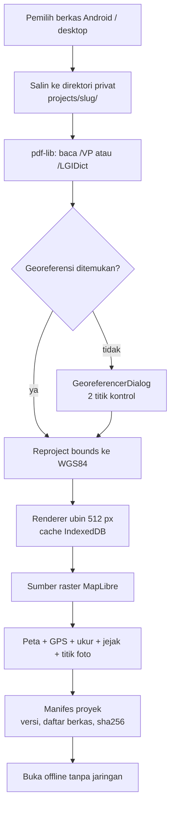
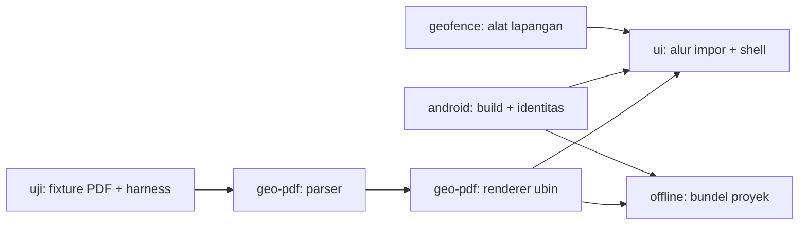

# Riset: Paritas Avenza Maps dan Stabilitas Android

**Tanggal:** 2026-10-19
**Pemilik:** lane `HQ` (dokumen), kerja implementasi menyebar ke lane lain
**Status:** riset selesai, siap dipecah jadi unit kerja
**Permintaan owner (topic 37, 2026-10-19):** aplikasi berjalan normal di Android tanpa macet, fungsi dan UI/UX setara Avenza Maps, dan yang paling penting: impor peta PDF yang sudah bertitik koordinat, lalu dipakai offline untuk lacak posisi, ukur, rekam jejak, dan taruh titik berikut foto.

---

## 1. Ringkasan eksekutif

Lima temuan yang menentukan arah kerja:

1. **Bahan bakunya sudah ada, yang hilang adalah sambungannya.** Repo ini sudah punya pengukur jarak (`maplibre-dimensions.ts`, 1461 baris), perekam jejak GPS (`gps-tracking.ts`, 409 baris, plus dialog 1488 baris), koleksi lapangan berikut foto (`field-collection.ts`, `FieldCollectionDialog.tsx` 1569 baris), georeferensi manual gambar (`GeoreferencerDialog.tsx`, 669 baris), peta offline (`offline-regions.ts`, `offline-tiles.ts`, `mbtiles.ts`), dan layar muka bergaya Avenza (`HomeScreen.tsx`, 116 baris, sudah dipasang di `App.tsx:91`). Tidak ada satu pun yang perlu dibangun dari nol.
2. **Impor GeoPDF saat ini tidak bisa membaca georeferensi yang sebenarnya.** Parser yang ada menyapu teks metadata Info/XMP, sedangkan titik koordinat peta PDF hidup di kamus halaman `/VP` (`/Measure`, `/LGIDict`). Artinya: PDF hasil ArcMap, QGIS, atau Avenza akan ditolak dengan pesan "bukan GeoPDF". Ini akar masalah fitur nomor satu yang diminta owner.
3. **Cara render PDF sekarang menjamin aplikasi macet di Android.** Satu halaman dirender jadi satu kanvas raksasa pada skala 2. Untuk kertas A1 (594 x 841 mm) itu sekitar 95 juta piksel, sekitar 380 MB RAM sebelum kompresi. WebView Android akan dibunuh sistem. Ini kandidat terkuat penyebab "stuck" yang owner alami, dan harus diganti menjadi ubin (tile) sebelum fitur lain ditumpuk di atasnya.
4. **Proyek belum portabel, jadi "offline" belum benar-benar offline.** Peta PDF dan fitur masih menunjuk berkas luar; di Android, URI `content://` dari pemilih berkas mati bersama proses. Tanpa salinan ke direktori privat aplikasi, membuka ulang proyek setelah aplikasi ditutup akan gagal.
5. **Build Android punya satu cacat yang bisa langsung menggagalkan rilis.** `MainActivity.kt` disalin ke `src-tauri/gen/android/app/src/main/java/org/geolibre/app/`, sedangkan `identifier` di `tauri.android.conf.json` adalah `com.geokebun.app`. Tauri menaruh berkas hasil generate mengikuti identifier, jadi langkah `test -f` di `.github/workflows/android.yml:167` akan gagal sebelum Gradle jalan.

Kesimpulan: target "setara Avenza" realistis, tetapi urutannya tidak boleh dibalik. Georeferensi dan render berubin dulu, karena UI, offline, dan pengukuran semuanya bergantung pada peta yang benar-benar punya koordinat.

---

## 2. Metode dan sumber

| Sumber | Dipakai untuk | Tanggal akses |
|---|---|---|
| Daftar aplikasi Google Play Avenza Maps (`play.google.com/store/apps/details?id=com.Avenza`) | inventaris fitur yang dijual Avenza, termasuk batas paket Plus/Pro | 2026-10-19 |
| Halaman fitur dan harga Avenza (`store.avenza.com/pages/app-features`, `/pricing`) | konfirmasi kelas fitur; halaman diblokir Cloudflare dari host ini, isinya dibaca lewat kutipan mesin pencari | 2026-10-19 |
| Dokumentasi driver PDF GDAL (`gdal.org/en/stable/drivers/raster/pdf.html`) | cara pembaca GeoPDF yang sudah matang bekerja | 2026-10-19 |
| ISO 32000-2 bagian 14.12 dan Adobe Supplement to ISO 32000-1 ExtensionLevel 3 | struktur `/VP`, `/Measure`, `/GPTS`, `/LPTS`, `/Bounds` | rujukan standar |
| OGC Best Practice 08-139r3 (GeoPDF Encoding, TerraGo) | struktur `/LGIDict`, `/CTM`, `/Neatline`, `/Registration` | rujukan standar |
| Pohon `~/GeoApps` pada `4f73d2b1` | audit kondisi nyata repo | 2026-10-19 |

Yang **tidak** bisa dibuktikan di sesi ini dan harus dinyatakan apa adanya: tidak ada `node_modules` di pohon ini, jadi tidak ada build atau uji yang dijalankan. Seluruh temuan kode di bawah berasal dari membaca berkas dan riwayat git, bukan dari menjalankan aplikasi.

---

## 3. Fitur Avenza yang jadi patokan

Kutipan langsung dari daftar Google Play (2026-10-19):

> "View your real-time GPS position without connectivity. Record GPS tracks for hiking, biking, and field activities. Navigate using compass and coordinate tools. Measure distance, area, and estimated travel time. Add placemarks, photos, and notes to any location. Identify locations precisely using what3words. Import and export KML, GPX, CSV, and other geospatial formats."

Batas paket, dari halaman yang sama:

| Paket | Batas impor peta | Fitur pembeda |
|---|---|---|
| Gratis | peta dari toko Avenza | lihat peta, rekam jejak, tempatkan penanda dan foto |
| Plus | sampai 20 impor PDF/GeoPDF/GeoTIFF | geofence untuk pemberitahuan lokasi |
| Pro | tanpa batas | rata-rata GPS, format koordinat, impor-ekspor Shapefile, simbologi khusus, GPS eksternal presisi tinggi (Trimble, Bad Elf, Dual), geofence tanpa batas |

### 3.1 Yang wajib ada di GeoApps (P0, diminta owner)

| # | Kemampuan | Kondisi repo sekarang |
|---|---|---|
| 1 | Impor PDF bergeoreferensi dan tampil tepat di koordinatnya | ada jalur, tetapi parser tidak membaca `/VP`; belum ada berkas uji PDF sama sekali |
| 2 | Posisi GPS langsung di atas peta, tanpa internet | ada (`geolocation.ts` sudah memakai plugin native di mobile) |
| 3 | Rekam jejak perjalanan | ada (`gps-tracking.ts`, `GpsTrackingDialog.tsx`) |
| 4 | Ukur jarak dan luas di peta | ada (`maplibre-dimensions.ts`) |
| 5 | Titik berikut foto dan catatan | ada (`field-collection.ts`, batas foto 2 MB) |
| 6 | Semua di atas tetap jalan setelah aplikasi ditutup dan tanpa sinyal | belum; proyek belum mengikat berkasnya sendiri |
| 7 | Aplikasi tidak macet di Android | belum terbukti; satu kandidat penyebab kuat sudah ditemukan (render PDF) |

### 3.2 Yang menyusul (P1)

Ekspor-impor GPX/KML/CSV, format koordinat (DD, DMS, UTM, MGRS), rata-rata GPS, geofence dengan notifikasi, kompas, perkiraan waktu tempuh, dan pencarian penanda.

### 3.3 Yang sengaja tidak dikejar

what3words (layanan berbayar dan butuh jaringan), GPS eksternal Bluetooth presisi tinggi, toko peta, dan langganan. Semuanya di luar kebutuhan lapangan yang disebut owner.

---

## 4. Kondisi repo: audit per kemampuan

| Kemampuan | Berkas | Baris | Catatan |
|---|---|---|---|
| Parser GeoPDF | `packages/plugins/src/plugins/geopdf/geopdf-parser.ts` | 113 | hanya regex atas teks metadata; tidak membaca kamus halaman |
| Render GeoPDF | `packages/plugins/src/plugins/geopdf/geopdf-render.ts` | 46 | satu kanvas, `scale = 2`, halaman pertama saja |
| Sambungan ke raster | `packages/plugins/src/plugins/maplibre-raster.ts:470-489` | 20 | memicu impor bila nama berkas berakhiran `.pdf` |
| Pengukur | `packages/plugins/src/plugins/maplibre-dimensions.ts` | 1461 | plugin, belum tentu nyaman di layar sentuh |
| Jejak GPS | `apps/geolibre-desktop/src/lib/gps-tracking.ts` + `GpsTrackingDialog.tsx` | 409 + 1488 | sudah ada, perlu uji lapangan |
| Koleksi lapangan | `apps/geolibre-desktop/src/lib/field-collection.ts` + `FieldCollectionDialog.tsx` | 1569 (dialog) | foto disimpan di properti `geolibre_photos`, batas 2 MB per foto |
| Georeferensi manual | `apps/geolibre-desktop/src/components/layout/GeoreferencerDialog.tsx` | 669 | memakai `gdal3.js` 2.8.1 untuk ekspor GeoTIFF |
| Peta offline | `apps/geolibre-desktop/src/lib/offline-regions.ts`, `offline-tiles.ts`, `mbtiles.ts` | — | cache tile per wilayah, MBTiles lewat perintah Tauri |
| Layar muka | `apps/geolibre-desktop/src/components/layout/HomeScreen.tsx` | 116 | dua tab, bergaya Avenza, sudah dipasang |
| Geolocation mobile | `apps/geolibre-desktop/src/lib/geolocation.ts` | 183 | sudah memakai `@tauri-apps/plugin-geolocation`, bukan `navigator.geolocation` |
| Identitas Android | `src-tauri/tauri.android.conf.json` | 15 | `identifier: com.geokebun.app`, `productName: GeoKebun` |
| Workflow Android | `.github/workflows/android.yml` | 300+ | menyalin `MainActivity.kt` ke jalur `org/geolibre/app` yang tidak lagi dibuat |

Riwayat yang relevan: `42bf885d` ("bring field-mapping work from GeoKebun") memasukkan seluruh bahan lapangan di atas dalam satu merge. Sejak itu belum ada pekerjaan lanjutan; papan tugas `adi805/GeoApps` masih nol issue dan label `lane:*` belum dibuat.

---

## 5. Celah teknis dan keputusan yang diusulkan

### 5.1 Parser georeferensi harus membaca kamus PDF, bukan teks

Georeferensi peta PDF tidak pernah berada di metadata Info/XMP. Ia berada di kamus halaman:

| Keluaran | Struktur | Isi kunci |
|---|---|---|
| Adobe / ISO 32000-2 (Geospatial PDF) | `/VP` (array viewport) berisi `/Measure` dengan `/Subtype /GEO` | `/GCS`, `/GPTS` (pasangan lintang-bujur), `/LPTS` (pasangan koordinat halaman), `/Bounds` |
| OGC Best Practice (TerraGo GeoPDF) | `/LGIDict` | `/CTM` (matriks transformasi), `/Neatline`, `/Registration` (pasangan koordinat peta dan halaman), `/Projection`, `/Datum` |
| ESRI ArcMap | `/VP` mengikuti bentuk Adobe | sama dengan baris pertama, kadang ditambah kunci privat |

`pdfjs-dist` 6.2.108 menyediakan `getMetadata()` (Info dan XMP), `getPage()`, `render()`, dan `getTextContent()`. Tidak ada API publik untuk membaca kamus `/VP` atau `/LGIDict` mentah. Karena itu pendekatan yang dipakai sekarang tidak bisa diperbaiki dengan regex yang lebih pintar.

**Keputusan yang diusulkan:** pakai `pdf-lib` untuk menyusuri objek PDF (ia membaca kamus, object stream, dan array), lalu pakai `pdfjs-dist` hanya untuk merender piksel. Pemisahan ini penting: `pdf-lib` kuat di struktur, `pdf.js` kuat di render, dan tidak ada satu pustaka yang bagus di keduanya.

Yang wajib ditangani parser:

1. `/VP` pada Adobe/ISO dan ESRI, termasuk `/Measure` bersarang.
2. `/LGIDict` pada GeoPDF OGC lama.
3. Lebih dari satu halaman: tiap halaman bisa punya viewport sendiri. Avenza memperlakukan tiap halaman sebagai peta terpisah; kita ikuti.
4. CRS proyeksi (mis. UTM 48S, EPSG:32748 untuk wilayah TSJ). Batas harus direproyeksi ke WGS84 sebelum masuk MapLibre.
5. Rotasi: bila `/CTM` memuat rotasi, batas kotak saja tidak cukup; sudut ubin harus direproyeksi satu per satu.
6. PDF tanpa georeferensi: jangan ditolak mentah. Arahkan ke `GeoreferencerDialog` yang sudah ada untuk dua titik kontrol. Ini nilai tambah di atas Avenza, karena banyak peta cetak Indonesia tidak bergeoreferensi.

### 5.2 Render harus berubin, bukan satu kanvas

Angka konkret: halaman A1 pada 72 dpi adalah 2384 x 3370 titik. Pada `scale = 2` menjadi 4768 x 6740 piksel, sekitar 32 juta piksel, sekitar 128 MB sebagai RGBA. Kanvas WebView Android umumnya dibatasi jauh di bawah itu, dan `image` source MapLibre adalah satu tekstur yang dibatasi `MAX_TEXTURE_SIZE` perangkat (sering 4096).

**Keputusan yang diusulkan:** render per ubin 512 atau 1024 piksel, simpan sebagai blob, dan sajikan lewat sumber raster khusus yang menghitung ubin sesuai zoom. Batas memori: maksimal dua ubin hidup pada satu waktu, sisanya di-cache ke IndexedDB atau disk. Skala render mengikuti zoom, bukan angka tetap 2.

### 5.3 Proyek harus mengikat berkasnya sendiri

Di Android, berkas yang dipilih lewat pemilih sistem datang sebagai `content://` dan izin bacanya mati bersama proses. Proyek `.geolibre.json` yang hanya menyimpan jalur akan kosong saat dibuka lagi.

**Keputusan yang diusulkan:** saat impor, salin PDF, GeoTIFF, dan foto ke direktori privat aplikasi (`$APPLOCALDATA/projects/<slug>/`), simpan jalur relatif di proyek, dan tulis manifes kecil (versi, daftar berkas, ukuran, sha256). Membuka proyek berarti membuka manifes, bukan mencari berkas di luar.

### 5.4 Identitas paket Android

`identifier` menentukan nama paket yang dibakar permanen oleh Google Play pada unggahan pertama, dan sekaligus menentukan jalur `MainActivity` hasil generate. Sekarang `identifier` adalah `com.geokebun.app` sementara workflow menyalin ke `org/geolibre/app`. Salah satu harus berubah, dan yang tidak boleh berubah sembarangan adalah `identifier`, karena itu keputusan owner (lihat `factory/lanes.json`, eskalasi tingkat owner).

**Usulan:** pertahankan `com.geokebun.app` sampai owner memutuskan nama paket final, dan perbaiki workflow agar jalur `MainActivity` diturunkan dari `identifier` (baca dari `tauri.android.conf.json`), bukan ditulis harfiah. Perubahan `identifier` sendiri menunggu keputusan owner.

### 5.5 Stabilitas Android: hipotesis dan cara mengukurnya

Ini bagian yang paling mudah jadi tebakan, jadi dipisahkan tegas: **hipotesis, belum terbukti**.

| Hipotesis penyebab macet | Alasan | Cara membuktikan |
|---|---|---|
| Render PDF satu kanvas raksasa | lihat 5.2 | uji dengan PDF A1, ukur memori puncak, reproduksi di perangkat |
| Waktu mulai aplikasi terlalu panjang | bundel memuat banyak mesin WASM (DuckDB, Pyodide, gdal3) | ukur `performance.mark` dari proses sampai peta siap, target di bawah 5 detik |
| Pemulihan proyek awal menggantung | `useStartupProject` menahan seluruh shell selama restore | uji buka aplikasi dengan proyek rusak atau hilang, pastikan keluar dari splash |
| WebGL kehilangan konteks saat aplikasi ke latar | WebView Android membuang konteks GL | uji pindah aplikasi 10 kali, peta harus pulih tanpa muat ulang |
| Izin lokasi ditolak diam-diam | manifest hasil generate tidak memuat izin | sudah diperbaiki lewat plugin native; uji ulang di perangkat baru |

Ukuran keberhasilan yang dipakai: aplikasi dibuka, impor PDF 20 MB, rekam jejak 30 menit, taruh 10 titik berfoto, tutup aplikasi, buka lagi dalam mode pesawat. Tidak ada layar putih, tidak ada proses yang dimatikan sistem, dan tidak ada data yang hilang.

---

## 6. Arsitektur usulan

Urutan ketergantungan kerja:

---

## 7. Pembagian kerja per lane

Tiap baris menjadi satu issue di `adi805/GeoApps` dengan label `lane:<id>`. Kriteria selesai ditulis sebagai perintah yang bisa dijalankan, sesuai `factory/LAW.md` bagian 3.

| # | Lane | Unit kerja | Kriteria selesai (ringkas) | Depends on |
|---|---|---|---|---|
| 1 | `uji` | Fixture GeoPDF dan harness impor | `tests/fixtures/geopdf/` memuat minimal 4 berkas (ESRI, OGC, QGIS, PDF tanpa georeferensi) berikut `README.md` sumber dan lisensi; `node --import tsx --test tests/geopdf-fixtures.test.ts` lulus | — |
| 2 | `geo-pdf` | Parser `/VP` dan `/LGIDict` | uji parser lulus untuk 4 fixture; batas hasil parser berbeda kurang dari 0,0001 derajat dari nilai `gdalinfo` yang dicatat di uji | 1 |
| 3 | `geo-pdf` | Renderer ubin dan sumber raster | uji menghasilkan jumlah ubin yang benar untuk halaman A1; tidak ada kanvas lebih dari 1024 px; e2e impor menampilkan layer pada batas yang benar | 2 |
| 4 | `android` | Build, identitas, dan jalur `MainActivity` | `npx tauri android build --apk --split-per-abi` keluar 0; `aapt2 dump packagename` = nilai `identifier`; langkah salin `MainActivity` membaca identifier, bukan jalur harfiah | — |
| 5 | `offline` | Bundel proyek portabel | impor PDF + 20 titik + 3 foto, tutup paksa, buka lagi tanpa jaringan: peta dan seluruh fitur tampil; manifes memuat sha256 tiap berkas | 3 |
| 6 | `ui` | Shell mobile setara Avenza | pada viewport 412x915: navigasi bawah tiga tab, tombol tambah titik, lembar detail titik dengan foto, ukur dan rekam jejak terjangkau maksimal dua ketukan; tangkapan layar disimpan di `factory/receipts/` | 3, 4 |
| 7 | `geofence` | Alat lapangan: rata-rata GPS, format koordinat, jejak latar belakang | uji satuan untuk rata-rata dan konversi UTM lulus; rekaman jejak 30 menit dengan layar mati tersimpan utuh, bukti berupa berkas rekaman di `factory/receipts/` | 4 |
| 8 | `HQ` | Celah cakupan lane untuk penyimpanan proyek | `lanes.json` menutup jalur berkas bundel proyek; `sync_law.py --check` dan `gate_law_fresh.py` lulus | — |

Catatan penting untuk nomor 8: saat ini tidak ada lane yang boleh menulis `apps/geolibre-desktop/src/lib/project-bundle.ts`. Lane `offline` hanya memegang `offline-*.ts` dan `mbtiles.ts`, lane `ui` hanya `components/**` dan `hooks/**`. Tanpa perubahan cakupan, unit kerja nomor 5 akan ditolak `gate_commit_paths.py`. Ini harus selesai sebelum nomor 5 dimulai.

---

## 8. Risiko

| Risiko | Dampak | Mitigasi |
|---|---|---|
| PDF nyata di lapangan tidak memakai `/VP` maupun `/LGIDict` | fitur inti gagal pada berkas owner | uji dengan berkas owner lebih dulu, sebelum menulis parser panjang; sediakan jalur georeferensi manual |
| `pdf-lib` gagal membaca object stream pada PDF terenkripsi | impor gagal | deteksi terenkripsi, beri pesan jelas, jangan menebak |
| Renderer ubin memperlambat pembukaan peta | pengalaman lebih buruk daripada sekarang | ukur waktu sampai ubin pertama tampil, target di bawah 2 detik pada zoom awal |
| Perubahan `identifier` setelah unggahan Play | tidak bisa dibatalkan | jangan unggah ke Play sebelum owner memutuskan nama paket final |
| Uji Android tidak bisa otomatis penuh | regresi lolos | pakai daftar periksa manual berbekas rekaman, plus e2e web untuk regresi cepat |

---

## 9. Keputusan yang menunggu owner

1. **Nama paket final** untuk Google Play: pertahankan `com.geokebun.app`, atau pindah ke nama yang mengandung GeoApps sebelum unggahan pertama. Setelah unggahan pertama, ini tidak bisa diubah.
2. **Nama produk di layar**: `GeoKebun` (sekarang) atau `GeoApps`.
3. **Berkas PDF nyata** milik owner untuk dijadikan fixture uji. Tanpa satu berkas asli, parser hanya bisa diuji pada contoh publik, dan itu belum membuktikan apa pun tentang peta yang benar-benar dipakai di lapangan.

---

## 10. Sumber

1. Avenza Maps, daftar aplikasi Google Play, `https://play.google.com/store/apps/details?id=com.Avenza`, diakses 2026-10-19.
2. Avenza Maps, halaman fitur dan harga, `https://store.avenza.com/pages/app-features` dan `/pricing`, diakses 2026-10-19 (isi dibaca lewat kutipan mesin pencari karena halaman menolak permintaan langsung dari host ini).
3. GDAL, "PDF -- Geospatial PDF", `https://gdal.org/en/stable/drivers/raster/pdf.html`, diakses 2026-10-19. Catatan penting dari halaman itu: dukungan baca bergantung pada Poppler, PoDoFo, atau PDFium, bukan parser bawaan GDAL.
4. ISO 32000-2, bagian 14.12 (Geospatial features); Adobe Supplement to ISO 32000-1, ExtensionLevel 3.
5. OGC Best Practice 08-139r3, GeoPDF Encoding (TerraGo).
6. Pohon `~/GeoApps` pada commit `4f73d2b1`, termasuk merge `42bf885d`.
